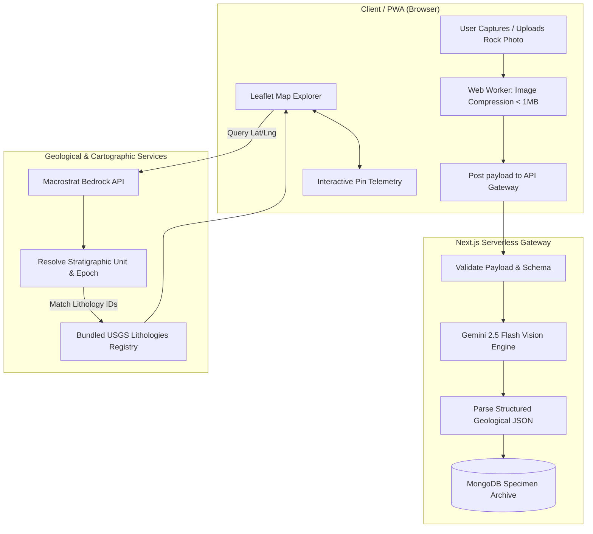

  

<h3 align="center">AI-Powered Rock, Mineral & Crystal Identifier with Geospatial Bedrock Mapping</h3>

  An interactive web application and installable PWA that identifies rocks, stones, and crystals from photos, maps findings on global satellite grids, and pulls real-time bedrock geological stratigraphy.

  
  
  

  
  
  
  
  
  
  
  

---

> [!NOTE]
> **Source Code Notice:** The core production codebase is kept in a private repository because Rocknify is an active, live product. I am happy to do a live code walkthrough, review implementation details, or show specific modules during technical interviews.

---

## 📸 Interface Showcase

Below are key screenshots of the production application in action:

| Screen | Description | Preview |
|---|---|---|
| **Landing & Scanner** | Clean hero with drag-and-drop / camera photo scanner and pre-upload compression | `docs/images/01-scanner.png` |
| **Analysis Results** | Mineral classification, Mohs hardness rating, formation story, and accuracy score | `docs/images/02-results.png` |
| **Global Discovery Map** | Crowdsourced Leaflet map with satellite toggle, place search, and specimen pins | `docs/images/03-explore-map.png` |
| **Stratigraphy & Bedrock** | Real-time Macrostrat bedrock survey showing formation name, era, and lithology tags | `docs/images/04-bedrock-profile.png` |
| **Personal Collection** | Specimen archive with grid/map views, editing modal, and public showcase links | `docs/images/05-collection.png` |

*(To add your own screenshots, place PNGs matching the filenames above in the `docs/images/` directory).*

---

## ⚡ What Does Rocknify Do?

Rocknify is designed for geology hobbyists, mineral collectors, and hikers who find interesting rocks in the field and want more than just a random guess.

1. **Instant Identification**: Snap or upload a photo of any rock, mineral, crystal, or gemstone to get classification, Mohs scale hardness, formation process, and similar rocks.
2. **Geospatial Discovery Network**: Every finding can be plotted onto an interactive world map. Users can toggle between standard street layouts and high-resolution Esri satellite imagery.
3. **Macrostrat Bedrock Analysis**: Clicking a specimen pin queries the Macrostrat geological survey API to reveal the underlying bedrock formation, era, and lithological rock units of the exact coordinates where it was found.
4. **Digital Collector Logbook**: Save findings into an organized personal collection, edit specimen field notes, pick GPS coordinates via an interactive map modal, and generate shareable showcase URLs.
5. **Field-Ready Progressive Web App (PWA)**: Installable directly on mobile home screens with offline awareness banners for low-signal exploration zones.

---

## 🛠️ Technology Stack

| Layer | Tools & Libraries | Purpose |
|---|---|---|
| **Framework** | Next.js 15.5 (App Router), React 19 | Server-side rendering, API routes, and client transitions |
| **Language** | TypeScript 5 | Strict end-to-end typing across components and data models |
| **AI / Vision** | Google Gemini 2.5 Flash | Multimodal vision model returning strict structured JSON data |
| **Geospatial** | Leaflet.js, OpenStreetMap, Esri Satellite | Dynamic interactive maps, custom animated pins, and aerial layers |
| **Geological APIs** | Macrostrat Point Geology API v2 | Live bedrock formation and chronostratigraphic data |
| **Styling & UI** | Tailwind CSS v4, Lucide React, Radix UI | Dark-mode native interface with custom ambient glows |
| **Database** | MongoDB & Mongoose | Specimen archives, metadata indexes, and user collections |
| **Media Pipeline** | browser-image-compression, Cloudinary | Client-side Web Worker image optimization and media hosting |
| **PWA & Offline** | @ducanh2912/next-pwa, Service Workers | Mobile installability, caching, and network status listeners |

---

## 🏗️ Architecture Overview

The application follows a clean separation between client-side processing, API gateway coordination, and specialized external services:

For a deeper dive into component responsibilities and data models, see [docs/architecture.md](docs/architecture.md).

---

## 💡 Engineering Highlights

Here are four real technical challenges I tackled while building Rocknify and how they were solved in the codebase:

### 1. Client-Side Image Compression with Web Workers
- **Challenge:** High-resolution phone camera photos are often 6MB–15MB. Sending raw uncompressed base64 images to serverless endpoints caused slow uploads, high mobile data usage, and Vercel payload limit errors.
- **Solution:** Integrated `browser-image-compression` running inside a background Web Worker (`useWebWorker: true`, `maxSizeMB: 1`, `maxWidthOrHeight: 1024`). Images are compressed client-side before base64 conversion, ensuring payloads stay under 1MB without blocking the main UI thread.

### 2. Bridging AI Predictions with Real Geological Bedrock Data
- **Challenge:** AI vision models identify the visual characteristics of a rock specimen, but cannot verify whether that rock naturally occurs in the ground where it was found.
- **Solution:** Combined the AI output with the **Macrostrat Point Geology API**. When a user selects a specimen with GPS coordinates on the Explore map, Rocknify queries Macrostrat for the regional bedrock unit, then matches numeric lithology IDs against a bundled static USGS lithology dictionary (`src/data/lithologies.ts`). This provides the user with verified geological age, formation name, and rock types for that exact location.

### 3. Hybrid Coordinate Parsing & Safe Map Normalization
- **Challenge:** Field findings come with varied location inputs: direct decimal pairs `(37.77, -122.41)`, location strings with trailing coordinates `"Grand Canyon (36.10, -112.11)"`, or simple place names without GPS.
- **Solution:** Implemented a multi-stage parser with strict regex coordinate extraction and WGS-84 coordinate clamping (`[-85, 85]` latitude, `[-180, 180]` longitude). For text-only locations without GPS, a deterministic bitwise hashing algorithm calculates consistent, non-overlapping visual map pins so the Leaflet map never crashes on unmapped records.

### 4. Field-Ready PWA & Offline State Awareness
- **Challenge:** Rock collectors and hikers frequently explore canyons, parks, and trails with intermittent or zero cell service.
- **Solution:** Configured full Progressive Web App support via `@ducanh2912/next-pwa` with custom splash logos and app manifests. Built active network status listeners (`window.ononline` / `window.onoffline`) with contextual visual banners in both the Explore map and Collection views, disabling network-dependent API calls gracefully while keeping cached views accessible.

---

## 🔍 Sanitized Code Excerpts

To showcase code quality and style without exposing the proprietary backend pipeline, a few simplified, illustrative code snippets are provided in [`examples/`](examples/):

- [`examples/types/specimen.ts`](examples/types/specimen.ts) — Clean TypeScript interface modeling the geological specimen and telemetry structure.
- [`examples/utils/coordinates.ts`](examples/utils/coordinates.ts) — Illustrative coordinate extraction and boundary clamping utility.
- [`examples/components/accuracy-badge.tsx`](examples/components/accuracy-badge.tsx) — Lightweight, accessible UI component demonstrating Tailwind dynamic styling.

---

## 📈 What I Learned

- **Working with multimodal vision models:** Crafting zero-budget deterministic token configurations and structured JSON schemas to ensure reliable, parseable outputs without conversational bloat.
- **Geospatial UI performance:** Handling dynamic Leaflet map initialization, avoiding SSR window bugs in Next.js, and efficiently swapping raster tile layers (OpenStreetMap vs. Esri Satellite) without memory leaks.
- **Practical PWA development:** The nuances of standalone display modes, mobile bottom-bar positioning, and user-facing offline indicators.

---

## 🚀 What I'd Build Next

1. **Multi-Parameter Filter Matrix:** Allow collectors to filter map specimens by Mohs hardness ranges, crystal system, and stratigraphic age era simultaneously.
2. **GIS Export Tools:** One-click export of saved personal collections to standard CSV and GeoJSON formats for import into desktop GIS tools like QGIS and ArcGIS.
3. **Local Offline Specimen Drafts:** Using IndexedDB to save full un-synced photo drafts locally while out in dead zones, automatically uploading them once cell reception returns.

---

## 📬 Contact & Links

- **Live Application:** [rocknify.vercel.app](https://rocknify.vercel.app/) / [rocknify.com](https://www.rocknify.com/)
- **Developer:** Hariom Gupta
- **GitHub:** [@HariomGupta0](https://github.com/HariomGupta0)
- **LinkedIn:** [linkedin.com/in/hariom-gupta](https://linkedin.com/in/hariom-gupta) <!-- replace with your actual link -->
- **Email:** `guptahariom349@gmail.com`

---

  Rocknify Showcase · Built with Next.js 15, React 19, Google Gemini & Leaflet.js

