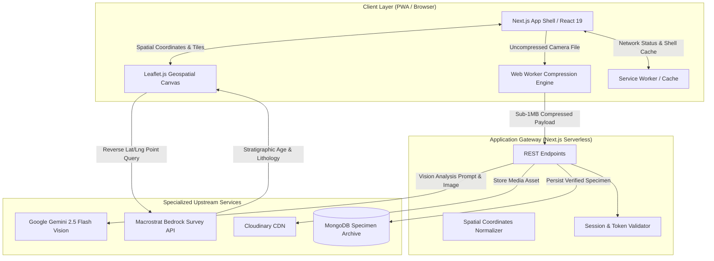

# Architecture & System Design — Rocknify

This document provides a high-level technical overview of Rocknify's architecture, component boundaries, and data pipelines. It is intended for technical evaluation and architectural walkthroughs.

---

## 1. High-Level Architecture Overview

Rocknify is designed around three decoupled layers: a client-side progressive application layer, a stateless serverless application gateway, and external domain services (multimodal AI and geological registries).



---

## 2. Component Responsibilities

### A. Client Presentation Layer
- **Interactive Scanning Interface**: Drag-and-drop or device camera capture with pre-upload visual validation.
- **Client-Side Compression Web Worker**: Resizes and recompresses raw camera photos (`~5–12MB`) to a web-optimized payload (`<1MB`) on a background thread using `browser-image-compression`, preventing UI stutter and request payload timeout errors.
- **Geospatial Canvas (Leaflet.js)**: Dynamically rendered map client supporting multi-layer toggling (OpenStreetMap cartography and Esri World Imagery satellite views) with fly-to zoom animations and marker clustering.
- **PWA Service Worker**: Intercepts app shell requests for field readiness and provides graceful degradation banners when mobile devices lose connectivity in remote geological field environments.

### B. Gateway & Pipeline Layer
- **Inference Coordinator**: Orchestrates image parsing, payload construction, and multimodal vision requests with structured schema enforcement.
- **Geographic Parser & Spatial Indexer**: Resolves incoming location formats (raw coordinate strings, formatted labels, or direct decimal inputs), clamps boundary ranges to valid WGS-84 coordinates, and deterministically normalizes unindexed locations to prevent map viewport collisions.
- **Specimen Vault Handler**: Manages user collections, public showcase link tokens, and CRUD lifecycle for saved field entries.

### C. External Integrations
- **Google Gemini 2.5 Flash**: Processes visual geological characteristics (cleavage, streak, luster, crystal habits, and matrix inclusions) and returns structured JSON responses matching strict mineralogical criteria.
- **Macrostrat Point Geology API**: Fetches real-time bedrock stratigraphy based on map coordinates, identifying the formation name, geological epoch, and underlying lithological units.
- **Static USGS Lithologies Index**: Localized dataset of standard rock classifications mapped to Macrostrat lithology identifiers for fast client-side taxonomic matching.

---

## 3. High-Level Data Models

### Specimen Record (Logical Structure)
```typescript
interface SpecimenRecord {
  id: string;                     // Unique record identifier
  userId: string;                 // Owning collector identifier
  imageUrl: string;               // Hosted image asset reference
  commonName: string;             // Primary recognized name (e.g. "Rose Quartz")
  scientificClassification: string; // Mineralogical group / chemical formula
  geologicalCategory: string;     // Igneous, Sedimentary, Metamorphic, Mineral
  confidenceScore: number;        // Deterministic classification score (0–100%)
  mohsHardness: string;           // Mohs scale estimate (e.g. "7.0")
  formationProcess: string;       // Narrative geological origin
  similarSpecimens: string[];     // Comparative mineral references
  locationLabel?: string;         // Human-readable location tag
  coordinates?: {
    latitude: number;
    longitude: number;
  };
  isPublic: boolean;              // Controls public showcase visibility
  createdAt: string;              // ISO timestamp
}
```

### Stratigraphic Unit Profile
```typescript
interface StratigraphicProfile {
  formationName: string;          // Formational or stratigraphic member name
  geologicalAge: string;          // Chronostratigraphic unit (e.g. "Late Cretaceous")
  lithologies: string[];          // Resolved primary rock types
  description: string;            // Official survey description
  accentColorHex?: string;        // Official geologic map unit color coding
}
```

---

## 4. Key Design Considerations

1. **Minimizing Cold Start Latency**: Lightweight bundle composition and dynamic script loading for mapping libraries to ensure snappy First Contentful Paint (FCP) on mobile networks.
2. **Deterministic Output Guarantees**: Leveraging structured JSON output modes with zero-budget deterministic token configurations on the vision model to eliminate conversational filler and ensure reliable parsing.
3. **Graceful Network Degradation**: The client handles intermittent network connectivity gracefully by maintaining an offline state banner and preserving active user form input during field excursions.
